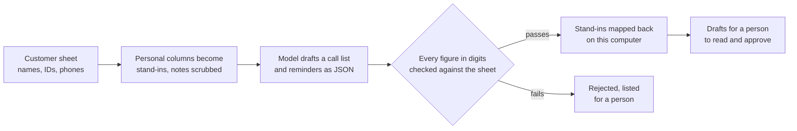

# AI collections follow-up demo

**An AI-assisted business workflow in which the personal columns never reach the model, and every figure the model writes in digits is checked against the sheet before a person reads it.**

[](https://github.com/evgenybl/ai-collections-followup-demo/actions/workflows/tests.yml)


[](LICENSE)

## The task

A small business, or the accounting office that serves it, keeps a sheet of customers who owe money. Every week someone decides whom to call first and writes the reminders. This pipeline does the routine part and leaves the judgment with a person.

## How it works



1. **The personal columns never reach the model.** The sheet is checked first: the needed columns must be there, and every amount and every delay must be a plain number. A sheet that fails is refused before anything is sent. Names, identity numbers, phones, e-mail addresses and street addresses become stand-ins such as `Customer 001`. The notes are scrubbed of the sheet's own personal values (as whole words, in any letter case) and of three common patterns: a phone number, an e-mail address and a nine-digit number. A name or a number written differently inside a note can still get through (see the limits below). A last guard refuses the run if any personal value of the sheet is still in the request. The key that maps the stand-ins back stays on your computer.
2. **The model gets only the four columns the task needs**, with a fixed prompt. It returns a ranked call list and a short reminder per customer, as JSON.
3. **Every figure the model writes in digits is checked against the sheet.** The amount must equal the customer's total exactly, and the days late the largest delay. A reminder may name only its own customer, may state only the total and the days late, and must state the total. A reason may state only that customer's own figures. A note for a person may state only figures that are in the sheet. A stand-in that does not exist in this run (such as `ID 777`) rejects the text it is in. A wrong total, an invented customer, a customer who has already paid, a figure of the wrong kind, or a text that breaks these rules is rejected and listed for a person. A customer the model left out is listed too.
4. **The stand-ins are mapped back to the real names locally.**
5. The call list, the reminder drafts, a page for a person and a run report are written to a new folder. The page for a person (`for-a-person.txt`) lists the notes, the rejected items, the missing customers and the rejected notes with the real names; the run report keeps stand-ins only. A run summary, with stand-ins only, can be sent to an automation trigger (an n8n or Make webhook) on the same computer. If the webhook fails, the outputs are kept and the run says so.

**Nothing is sent to any customer.** The pipeline has no send step at all, which is why the run report's `sent_to_customers` is always 0. The output is a draft for a person to read and approve.

## Run it

Python 3.13, standard library only. Nothing to install.

```
python -I test_pipeline.py
python -I pipeline.py --out out-run
python -I pipeline.py --print-request
```

The first command runs the tests. The second runs the pipeline on the synthetic sheet with the recorded model answer and writes into a new folder (it refuses to overwrite an existing one). The third prints the exact text a model would receive (UTF-8, with LF line ends), so you can see for yourself that no personal value is in it.

On the recorded answer the run prints:

```
backend recorded | owing 4 | accepted 4 | rejected 0 | missing 0 | rejected notes 0 | sent to customers 0
```

The exit code is 0 when the run is done; 2 when it is refused for a usage or setup reason (for example a missing file, an existing output folder, a sheet that fails its check, or a personal value in the request); 3 when the model's answer or the API cannot be used, in which case nothing is written; and 4 when the outputs were written but the webhook failed.

The live path is `--backend anthropic`. It reads the key from the `ANTHROPIC_API_KEY` environment variable and never prints or writes it.

## Files

| File | What it is |
|---|---|
| `pipeline.py` | The pipeline: the sheet check, the model request, the checks, the mapping back, the outputs |
| `pseudonymise.py` | Replaces the personal columns of a table with stable stand-ins, scrubs the other columns, and keeps a local key |
| `prompt.txt` | The fixed prompt |
| `customers.synthetic.csv` | The invented sheet: six rows, five invented customers, one of them on two rows |
| `recorded-answer.json` | One real answer from a Claude model to the printed request, saved unedited |
| `recorded-answer.meta.json` | Where the recorded answer came from: the model, the date, the route, and the sha256 of the request it answers. A test compares that sha256 with the request the pipeline builds today, so a changed prompt or sheet cannot silently keep an old recording |
| `test_pipeline.py` | The tests |

## What the tests cover

44 tests, 0 failures (`python -I test_pipeline.py`, Python 3.13). They also run on every push to main and on pull requests; the badge above shows the last result. One of them runs the recorded answer through the checks.

- the sheet is checked before anything is sent: a missing column (a header spelled `Name` included), an amount such as `4,200`, `-5` or an empty cell, a delay such as `45.0`, or an empty name is refused with the row and the column, and the model is not called;
- a missing sheet, prompt or recorded answer is refused;
- the model request carries no personal value and only the four needed columns, and its table is written by the csv module (quotes kept, a line break turned into a space);
- the pseudonymiser: the three patterns catch a phone, an e-mail address and a nine-digit number outside their columns; the sheet's own values are replaced as whole words in any letter case, longest first; a value written differently gets through, as the limits below say; its command line writes the clean sheet and the key, and refuses to overwrite;
- the leak guard refuses a request that still holds a personal value, before anything is sent;
- a correct answer is accepted whole;
- amounts are exact decimals: rows of 0.1 and 0.2 total 0.3, and 12345.67 and 1234567.89 are written and quoted as they are;
- a wrong total, wrong days late, a repeated or zero priority, the same customer twice, an item that is not an object, an invented customer and a paid-up customer are each rejected with the reason;
- a figure of the wrong kind is rejected: an amount written as text or as `true`, days late or a priority with a fraction or as `true`; a NaN or an infinity refuses the whole answer;
- a reminder that is empty, leaves out the total, states another figure, or holds another stand-in is rejected with what it is;
- a reason that states a figure that is not the customer's own, or names a stand-in from outside the customer's rows, is rejected;
- a note for a person with a figure that is not in the sheet, an unknown stand-in, or a value that is not text is set aside and listed;
- stand-ins are matched as exact tokens, so `Customer 1001` works in a sheet of more than 999 customers;
- a left-out customer is listed as missing;
- the page for a person carries the real names; the run report and the webhook payload carry stand-ins only;
- a fenced JSON answer is read; prose, a missing call list and a `for_a_human` that is not a list are refused, and an unusable answer writes nothing;
- an existing folder is never overwritten;
- the API path against a local mock of the Messages API: the right path, version header, model, `max_tokens` and key, and no personal value in the body; an HTTP error, a connection error, a body that is not JSON or not in the expected shape, and an answer cut off at `max_tokens` are each refused with nothing written;
- no key gives a clear refusal and nothing is written;
- the webhook receives stand-ins only; a webhook outside this computer is refused before anything runs; a failed webhook keeps the outputs and exits with 4;
- `--print-request` prints the exact request and needs no `--out`; every other run does;
- `recorded-answer.meta.json` has its four keys, and its sha256 matches the request built today.

## Limits, stated plainly

- **Synthetic data.** Every customer is invented, every e-mail address is at example.com, and the identity numbers and phone numbers are placeholders. No real person or business is in any file.
- **The live API path was tested against a local mock, not against the real service.** The mock answers in the documented shape of the Messages API.
- **One recorded model answer is not a measure of reliability.** Another run may order the list differently or make a mistake. The checks catch wrong figures and invented customers. They do not judge whether the order is wise; that stays with a person.
- **Figures are checked only when they are written in digits.** A number written in words, such as "thirty days", is not checked.
- **The pseudonymiser is a teaching aid, not a privacy product.** The personal columns never reach the model, but inside a note it finds only the sheet's own values, written the same way, and three common patterns. A name or a number written differently gets through: a note that says "call Alpha's brother on 000.000.0001" reaches the model as it is. It makes no legal claim.
- **Customers are told apart by the name column alone.** Two different people with the same name become one customer, and their rows are added together.
- **The webhook was tested against a local mock server.** No real n8n or Make instance was called.
- This is a demonstration of a design, not a product and not a record of client work.

## The design in one line

The AI drafts, a script verifies, a person approves.

## Licence

MIT. See [LICENSE](LICENSE).

## Author

Evgeny Blekhman · [LinkedIn](https://www.linkedin.com/in/evgeny-blekhman/)
