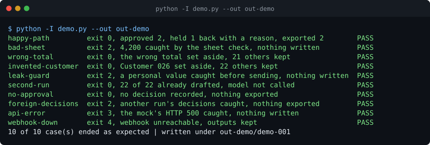
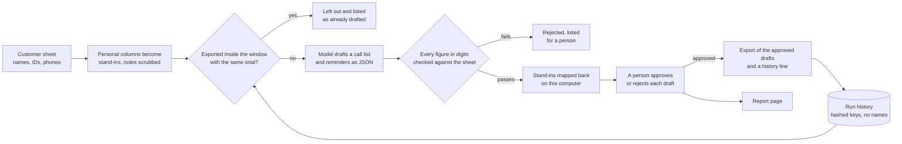

# AI Collections Follow-up

[](https://github.com/evgenybl/ai-collections-followup-demo/actions/workflows/tests.yml)    [](LICENSE)

A small business, or the office that keeps its books, chases unpaid invoices by hand every week, and one wrong figure in a reminder costs a customer's trust. This is a demonstration on invented data of another way: a model drafts the call list and the reminders, code checks every figure against the sheet, a person approves each draft before it is exported, and nothing is ever sent.

## What you see




*The closing table of a real run of `python -I demo.py --out out-demo`, drawn from its output by `tools/term_svg.py`. `make_examples.py` draws it again from a new run, and the CI workflow compares the two.*

The first five lines of the call list the example run drafted, from [`examples/call-list.csv`](examples/call-list.csv). Every name is invented:

```
priority,customer,amount,days_late,bucket,reason
1,Cobalt Bakery (invented),12295,123,over 90,"123 days late on 12295 owed, and the invoice is disputed, so the dispute needs settling on the call."
2,Quarry Laundry (invented),13585,98,over 90,"98 days late on 13585 owed, and it has asked to split the payment into two instalments."
3,Bramble Framing (invented),13995,75,61-90,"75 days late on 13995 owed, and it promised to pay by the end of the month, so check whether that promise holds."
4,Juniper Tile Works (invented),21655,47,31-60,"47 days late on 21655 owed, and it says the invoice never arrived, so the invoice should be resent first."
```

The order and the reasons are a real model's, from the recorded answer; every figure in them was checked against the sheet.

## Try it in two minutes

Python 3.11 or newer, standard library only, nothing to install. Run from the repository's folder:

```
python -I demo.py --out out-demo
```

runs the ten cases of the failure gallery. It prints a detailed line for each case, then the closing table shown above. The first line:

```
happy-path | expected: exit 0; the export holds only the approved drafts | happened: exit 0; 22 drafts; items 3 and 5 approved, item 1 rejected (a note names it), 19 pending; the export holds reminders reminder-03.txt, reminder-05.txt and call-list lines 3, 5; history lines 2; report written | PASS
```

```
python -I demo.py --case bad-sheet --out out-demo
```

runs one case:

```
bad-sheet | expected: refused before anything is sent, exit 2, nothing written | happened: exit 2; nothing written; REFUSED: row 2 of the sheet: amount_due '4,200' is not a plain decimal number of 0 or more | PASS
```

```
python -I report.py out-demo/demo-001/happy-path/run --out out-demo/report.html
```

writes the report page of the first command's happy path; open it in a browser:

```
report written to out-demo/report.html | customers owing 22 | waiting for a decision 19 | refused by the checks 0
```

### Take the decisions yourself

A run of the pipeline drafts; nothing leaves its folder until a person decides. Each command below is followed by the first line it printed in a real run (`list` prints one line per draft, then a count):

```
$ python -I pipeline.py --out out-run
backend recorded | owing 22 | accepted 22 | rejected 0 | missing 0 | rejected notes 1 | sent to customers 0
$ python -I approval.py list out-run
item 1 | Cobalt Bakery (invented) | 12295 | over 90 | pending
$ python -I approval.py approve out-run --item 1 --by "Your Name"
item 1: approved by Your Name at 2026-11-24T01:12:48Z
$ python -I approval.py reject out-run --item 2 --by "Your Name" --reason "Settle the instalment request first"
item 2: rejected by Your Name at 2026-11-24T01:12:48Z: Settle the instalment request first
$ python -I approval.py export out-run --history out-history.jsonl
exported items 1 to approved/ | rejected 1 | pending 20 | history lines added 1 | sent to customers 0
```

`out-run/approved/` now holds only the approved reminder and its call-list line. With `--history out-history.jsonl`, a later run leaves that customer out of the request while the export is inside the window and the total stays the same. `python -I report.py out-run --out out-run.html` writes the page with the decisions on it.

Every test runs with `python -I run_tests.py`. The CI workflow runs the tests, the whole demo, and `make_examples.py` followed by a git comparison of what it wrote, on Linux and Windows with Python 3.11 and 3.13.

## How it works



1. **The personal columns never reach the model.** `pipeline.py` checks the sheet first and refuses it before anything is sent if a column is missing or an amount or a delay is not a plain number. Names, identity numbers, phones, e-mail addresses and street addresses become stand-ins such as `Customer 001`; the notes are scrubbed; a last guard refuses the run if a personal value is still in the request.
2. **What was already drafted is left out.** With `--history`, a customer whose draft was approved and exported inside the window, with the same total, is not asked about again. The window is a draft exported fewer than N days before the as-of date, so ages 0 to N-1 (N is `--window-days`, 7 by default). A changed total is drafted again and marked. When everyone owing was already drafted, the model is not called at all.
3. **Every figure the model writes in digits is checked against the sheet.** The total and the days late must match exactly; a reminder may name only its own customer and state only its total and delay. Anything that fails is rejected and listed for a person. Each customer's ageing bucket (current, 1-30, 31-60, 61-90, over 90) is computed from the sheet, not asked of the model.
4. **A person decides.** `approval.py` records an approval or a rejection for each draft, with who and when, and exports only the approved ones, together with a line in the run history. It refuses decisions from another run and drafts changed after they were written.
5. **A person reads one page.** `report.py` writes a self-contained HTML page: the figures, the ageing, the call list with each decision, the drafts, what was refused, and what was already drafted.

**Nothing is sent to any customer.** There is no send step anywhere, and every run report says `"sent_to_customers": 0`. The design, and why it is this way, is in [`docs/DESIGN.md`](docs/DESIGN.md).

## What is real here

| Path | Kind | What was actually run |
|---|---|---|
| The model answer the demo replays (`recorded-answer.json`) | Recorded | One real answer from `claude-haiku-5-5` to the request built from the shipped sheet, recorded on 2026-11-24 by a Claude Code subagent given the request text as its whole prompt, and saved as returned. Tests check the sha256 of the request it answers and of the answer file itself. The checks accept all 22 owing customers. The first version's real answer to its six-row sheet is kept in `fixtures/`. |
| The live model path (`--backend anthropic`) | Mock | Tested against a local mock of the Messages API on 127.0.0.1, and at its default address with the network call replaced inside the test; never against the real service |
| The webhook (`--webhook`) | Mock | Tested against a local mock server; no real n8n or Make instance was called |
| The pipeline, the checks, the run history, the approval, the report, the demo | Local | They run on the reader's computer: `python -I run_tests.py` and `python -I demo.py --out out-demo` |

## What can go wrong, and what happens

The wrong answers and broken sheets in [`gallery/`](gallery/README.md) are constructed, not recorded: each is the recorded answer or the shipped sheet with one change, and `gallery/README.md` says which.

| Case | What goes wrong | What happens | Command |
|---|---|---|---|
| `happy-path` | Nothing: some drafts approved, one rejected | exit 0; the export holds only the approved drafts | `python -I demo.py --case happy-path --out out-demo` |
| `bad-sheet` | An amount written `4,200` | refused before anything is sent, exit 2, nothing written | `python -I demo.py --case bad-sheet --out out-demo` |
| `wrong-total` | The model's total differs from the sheet's | that item rejected with the reason; the others kept | `python -I demo.py --case wrong-total --out out-demo` |
| `invented-customer` | The model adds a customer who is not in the sheet | rejected | `python -I demo.py --case invented-customer --out out-demo` |
| `leak-guard` | A personal value still in the request | refused, exit 2, nothing sent | `python -I demo.py --case leak-guard --out out-demo` |
| `second-run` | The same sheet again inside the window, after an export | nothing is drafted twice; the model is not called | `python -I demo.py --case second-run --out out-demo` |
| `no-approval` | An export with no decision | nothing exported | `python -I demo.py --case no-approval --out out-demo` |
| `foreign-decisions` | A decisions file from another run | refused, exit 2 | `python -I demo.py --case foreign-decisions --out out-demo` |
| `api-error` | The live path against a local mock that answers 500 | refused, exit 3, nothing written | `python -I demo.py --case api-error --out out-demo` |
| `webhook-down` | The webhook is unreachable | outputs kept, exit 4 | `python -I demo.py --case webhook-down --out out-demo` |

## Limits, stated plainly

- **Synthetic data.** Every customer is an invented business whose name ends in "(invented)", every e-mail address is at example.com, and the identity numbers and phone numbers are placeholders. No real person or business is in any file.
- **One recorded model answer is not a measure of reliability.** Another run may order the list differently or make a mistake. The checks catch wrong figures and invented customers. They do not judge whether the order is wise; that stays with a person.
- **The live API path was tested against a local mock, not against the real service.** The mock answers in the documented shape of the Messages API.
- **Figures are checked only when they are written in digits.** A number written in words, such as "thirty days", is not checked.
- **The pseudonymiser is a teaching aid, not a privacy product.** Inside a note it finds only the sheet's own values, written the same way, and three common patterns. A name or a number written differently gets through. It makes no legal claim.
- **Customers are told apart by the name column alone.** Two different people with the same name become one customer, and their rows are added together.
- **The approval records a name and does not authenticate.** `--by` is whatever the person types.
- **The history key is a hash, and a hash of a name is not anonymous.** The history file holds no name, but anyone who has the sheet can compute the same key, and a guessed name can be tested against it.
- **Ageing is computed from the sheet's own delay column.** It is as current as that column, not worked out from invoice dates.
- **A cell that a spreadsheet could run as a formula is written as text.** In every CSV file this project writes, a cell that starts with `=`, `+`, `-`, `@`, a tab or a carriage return gets a leading apostrophe, and the page for a person says how many cells were changed. Some programs show that apostrophe. `--by` may not start with those characters at all.
- **A changed draft is detected, not prevented.** The check guards against accidents, not against someone who also edits the run report.
- **The webhook was tested against a local mock server.** No real n8n or Make instance was called.
- This is a demonstration of a design, not a product and not a record of client work.

## How this was built

Written with Claude Code under the author's direction. Every claim on this page is backed by a test or a command the reader can run: the tests are listed in [`docs/TESTS.md`](docs/TESTS.md).

## Origins

The first version of this demo had a six-row sheet and one real model answer to it; both are kept in `fixtures/`, with the tests written for them. The design in one line has not changed: the AI drafts, a script verifies, a person approves.

## Licence

MIT. See [LICENSE](LICENSE).

## Author

Evgeny Blekhman · [LinkedIn](https://www.linkedin.com/in/evgeny-blekhman/)
